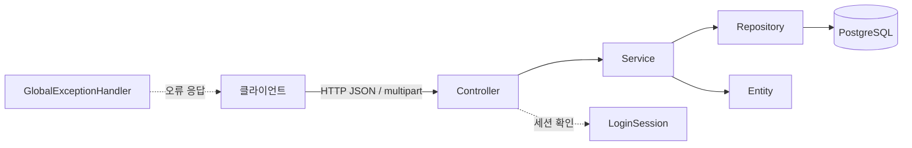
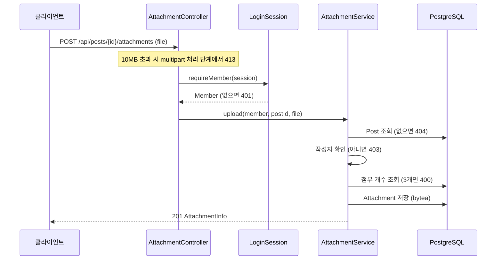
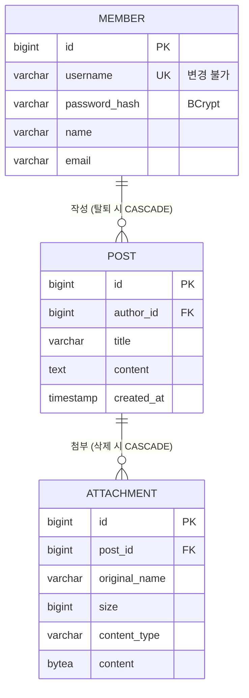

# Design Document

## Overview

파일 첨부가 가능한 게시판 REST API의 설계 문서입니다. 요구사항은 `requirements.md`를 따르며, 구현 방법에 관한 결정은 이 문서에서 확정합니다.

- 기술 환경: Java 21, Spring Boot 3.x, Gradle, Spring Data JPA, PostgreSQL
- 소스 위치: `Src/` 하위 (패키지는 `com.example.board`)
- 원칙: `AGENTS.md`의 "Simple is Best". 인터페이스, 별도 도메인/DTO 변환 계층, 멀티 모듈 등은 만들지 않습니다.
- 범위 밖: 화면(UI), 관리자 기능, 파일 미리보기

### 설계 결정

요구사항의 "설계에서 결정할 사항"을 아래와 같이 확정합니다. 모두 가장 단순한 쪽을 골랐습니다.

| 번호 | 항목 | 결정 | 이유 |
|------|------|------|------|
| 1 | 업로드 파일 저장 방식 | PostgreSQL `bytea` 컬럼(Blob)에 저장 | 파일 저장 경로 설정, 고아 파일 정리, 글 삭제 시 파일 동기화가 필요 없다. Post 삭제 시 DB 트랜잭션 하나로 함께 지워진다. 파일이 최대 10MB, 글당 3개라 학습용으로 DB 부담이 크지 않다. |
| 2 | 인증 방식 | 서버 세션(`HttpSession`, `JSESSIONID` 쿠키) | JWT는 토큰 발급, 검증, 만료, 폐기 처리가 따로 필요하다. 세션은 로그아웃과 탈퇴 시 `invalidate()` 한 번으로 요구사항 3.3, 5.2를 만족한다. |
| 3 | 비밀번호 해시 | BCrypt (`spring-security-crypto`의 `BCryptPasswordEncoder`) | Spring Security 전체(필터 체인)를 들이지 않고 암호화 모듈만 사용한다. 비밀번호는 최대 20자로 제한한다(BCrypt는 72바이트까지만 반영하며, 20자는 UTF-8로 60바이트 이하다). |
| 4 | 회원탈퇴 시 작성 글 | 글과 첨부파일을 함께 삭제 | 작성자 표시 변경(탈퇴 회원 처리)은 추가 컬럼과 화면 규칙이 필요하다. DB의 `ON DELETE CASCADE` 한 줄로 처리된다. |
| 5 | Max_File_Size, Max_File_Count | 10MB, 3개로 확정 | 초기값을 그대로 사용한다. 크기는 `application.yml`, 개수는 코드 상수로 둔다. |
| 6 | 허용 파일 형식 | 제한 없음 | 학습용이며 요구사항에 형식 제한이 없다. 대신 다운로드 시 항상 `attachment`로 내려보내 브라우저가 파일을 직접 실행하거나 렌더링하지 않게 한다. |
| 7 | 조회, 다운로드의 로그인 필요 여부 | 로그인 없이 허용 | 요구사항의 가정을 따른다. 작성, 수정, 삭제, 회원정보 변경, 업로드만 로그인이 필요하다. |
| 8 | 첨부파일 전송 방식 | Post 저장과 분리된 별도 요청 | 요구사항 11이 "Post에 파일 업로드 요청"을 기준으로 쓰여 있다. 글은 JSON, 파일은 multipart로 나누면 요청 하나에 파일 하나라 크기와 개수 검사가 단순해진다. |

### 참고한 자료

- Spring Boot의 multipart 기본 제한은 파일 1MB, 요청 10MB입니다. 10MB 파일을 받으려면 설정을 명시해야 합니다 ([How to Handle Large File Uploads in Spring Boot](https://oneuptime.com/blog/post/2026-01-25-large-file-uploads-spring-boot/view), 내용을 요약함).
- Hibernate는 `@Lob byte[]`를 PostgreSQL에서 `oid`(별도 large object)로 매핑하는 것으로 알려져 있어, `@Lob` 없이 `byte[]`만 사용해 `bytea`로 저장합니다.

## Architecture

요청은 Controller, Service, Repository 세 단계로만 흐릅니다. Entity가 업무 규칙(작성자 확인, 수정)을 직접 가집니다.



### 패키지 구성

```
com.example.board
├── BoardApplication
├── common     ApiException, ErrorResponse, GlobalExceptionHandler, LoginSession, DbChecker, DbCheckController
├── member     Member, MemberRepository, MemberService, MemberController, 요청/응답 record
├── post       Post, PostRepository, PostService, PostController, 요청/응답 record
└── attachment Attachment, AttachmentRepository, AttachmentService, AttachmentController, 응답 record
```

### 업로드 흐름



## Components and Interfaces

### API 목록

| 기능 | 메서드와 경로 | 로그인 | 성공 응답 |
|------|---------------|--------|-----------|
| DB 연결 확인 | `GET /api/health/db` | 불필요 | 200 `{"status":"UP"}`, 실패 시 503 |
| 회원가입 | `POST /api/members` | 불필요 | 201 |
| 로그인 | `POST /api/login` | 불필요 | 200 |
| 로그아웃 | `POST /api/logout` | 불필요 | 204 |
| 회원정보 수정 | `PUT /api/members/me` | 필요 | 200 |
| 회원탈퇴 | `DELETE /api/members/me` | 필요 | 204 |
| 게시글 목록 | `GET /api/posts?page=0` | 불필요 | 200 `List<PostSummary>` |
| 게시글 상세 | `GET /api/posts/{id}` | 불필요 | 200 `PostDetail` |
| 게시글 저장 | `POST /api/posts` | 필요 | 201 `{"id": 번호}` |
| 게시글 편집 | `PUT /api/posts/{id}` | 필요 | 200 |
| 게시글 삭제 | `DELETE /api/posts/{id}` | 필요 | 204 |
| 파일 업로드 | `POST /api/posts/{id}/attachments` (multipart, 파트 이름 `file`) | 필요 | 201 `AttachmentInfo` |
| 첨부파일 삭제 | `DELETE /api/attachments/{id}` | 필요 | 204 |
| 첨부파일 다운로드 | `GET /api/attachments/{id}` | 불필요 | 200 (원본 바이트) |

### 주요 클래스

| 클래스 | 역할 |
|--------|------|
| `LoginSession` | 세션에 회원 번호를 저장, 조회, 제거한다. 세션에 없거나 DB에 회원이 없으면 401을 던진다. |
| `MemberService` | 가입(아이디 중복 확인, 해시 저장), 로그인(해시 비교), 정보 수정, 탈퇴 |
| `PostService` | 목록, 상세, 저장, 편집, 삭제. 작성자 확인은 `Post.isWrittenBy(member)`로 한다. |
| `AttachmentService` | 업로드(작성자, 개수 확인), 삭제, 다운로드 조회 |
| `DbChecker` | 연결을 한 번 확인한다. 기동 시(`ApplicationRunner`) 결과를 로그에 남기고, `DbCheckController`가 같은 메서드를 호출한다. |
| `GlobalExceptionHandler` | `ApiException`, 검증 오류, 업로드 크기 초과를 JSON 오류 응답으로 바꾼다. |

### LoginSession

```java
@Component
public class LoginSession {
    void login(HttpServletRequest request, Member member); // 기존 세션 폐기 후 새 세션 생성(세션 고정 공격 방지)
    Member requireMember(HttpSession session);             // 로그인하지 않았거나 탈퇴한 회원이면 401
    void logout(HttpSession session);                      // invalidate()
}
```

탈퇴한 회원의 다른 세션이 남아 있어도 `requireMember`가 DB에서 회원을 다시 조회하므로 401이 됩니다. 요구사항 5.2의 "Login_Session 무효화"는 현재 세션 `invalidate()`와 이 조회로 충족합니다.

### 요청과 응답 (record)

```java
record JoinRequest(@NotBlank String username, @NotBlank @Size(max = 20) String password,
                   @NotBlank String name, @NotBlank String email) {}
record LoginRequest(@NotBlank String username, @NotBlank String password) {}
record MemberUpdateRequest(@NotBlank String name, @NotBlank String email,
                           @Size(max = 20) String password) {} // password가 비어 있으면 변경하지 않는다

record PostRequest(@NotBlank String title, @NotBlank String content) {}
record PostSummary(Long id, String title, String authorName, LocalDateTime createdAt) {}
record PostDetail(Long id, String title, String content, String authorName,
                  LocalDateTime createdAt, List<AttachmentInfo> attachments) {}
record AttachmentInfo(Long id, String originalName, long size, String contentType) {}
record ErrorResponse(String message, List<String> fields) {} // fields는 검증 오류일 때만 포함
```

### 처리 규칙

- 목록: `PageRequest.of(max(page, 0), 10)`, 정렬은 번호 내림차순(`order by p.id desc`). 번호가 작성 순서대로 증가하므로 최신 작성순과 같다. JPQL `select new PostSummary(...)`로 필요한 컬럼만 조회한다.
- 상세: Post를 조회하고, 첨부 목록은 `select new AttachmentInfo(...)`로 조회한다. `content`(bytea)는 읽지 않는다.
- 다운로드: `Content-Disposition: attachment`에 원본 파일명을 UTF-8로 지정(`ContentDisposition.attachment().filename(name, UTF_8)`)하고, 저장해 둔 `contentType`으로 응답한다. 10MB 이하라 `byte[]`를 그대로 반환한다.
- 업로드 순서: 로그인(401), Post 존재(404), 작성자(403), 개수 3개 이상(400), 저장 순으로 확인한다. 크기 초과(413)는 컨트롤러에 들어오기 전에 multipart 처리에서 걸린다.
- 로그인 실패: 아이디가 없든 비밀번호가 틀리든 같은 401 메시지를 반환한다.
- 서비스 메서드는 `@Transactional`로 감싸고 응답 record까지 서비스 안에서 만든다. `spring.jpa.open-in-view=false`로 두어 지연 로딩이 트랜잭션 밖으로 새지 않게 한다.

### 설정 (`application.yml`)

```yaml
spring:
  datasource:
    url: ${DB_URL:jdbc:postgresql://localhost:5432/board}
    username: ${DB_USERNAME}
    password: ${DB_PASSWORD}
  jpa:
    hibernate.ddl-auto: update   # 학습용. 별도 마이그레이션 도구는 쓰지 않는다.
    open-in-view: false
  servlet:
    multipart:
      max-file-size: 10MB        # Max_File_Size
      max-request-size: 11MB     # 파일 1개 + 멀티파트 오버헤드
```

DB 접속 계정과 비밀번호는 환경변수로 받으며 코드와 저장소에 넣지 않습니다.

### 의존성

`spring-boot-starter-web`, `spring-boot-starter-data-jpa`, `spring-boot-starter-validation`, `org.postgresql:postgresql`, `org.springframework.security:spring-security-crypto`, 테스트용 `spring-boot-starter-test`, `jqwik`, `jqwik-spring`

`spring-boot-starter-security`는 넣지 않습니다. 넣으면 모든 요청에 기본 보안 필터가 적용되어 설정할 것이 늘어납니다. 그 대신 CSRF 방어는 적용되지 않으므로, 학습용 API라는 전제에서 범위 밖으로 둡니다.

## Data Models



### Entity

```java
@Entity
public class Member {
    @Id @GeneratedValue(strategy = GenerationType.IDENTITY) private Long id;
    @Column(nullable = false, unique = true) private String username; // setter 없음
    @Column(nullable = false) private String passwordHash;
    @Column(nullable = false) private String name;
    @Column(nullable = false) private String email;

    public void update(String name, String email, String newPasswordHash) {} // newPasswordHash가 null이면 비밀번호 유지
}

@Entity
public class Post {
    @Id @GeneratedValue(strategy = GenerationType.IDENTITY) private Long id;
    @ManyToOne(fetch = FetchType.LAZY, optional = false)
    @OnDelete(action = OnDeleteAction.CASCADE)                 // 회원 삭제 시 글도 삭제
    private Member author;
    @Column(nullable = false) private String title;
    @Column(nullable = false, columnDefinition = "text") private String content;
    @Column(nullable = false) private LocalDateTime createdAt; // 생성자에서 현재 시각 지정

    public boolean isWrittenBy(Member member) {}
    public void update(String title, String content) {}
}

@Entity
public class Attachment {
    @Id @GeneratedValue(strategy = GenerationType.IDENTITY) private Long id;
    @ManyToOne(fetch = FetchType.LAZY, optional = false)
    @OnDelete(action = OnDeleteAction.CASCADE)                 // 글 삭제 시 첨부도 삭제
    private Post post;
    @Column(nullable = false) private String originalName;
    @Column(nullable = false) private long size;
    @Column(nullable = false) private String contentType;
    @Column(nullable = false) private byte[] content;          // @Lob을 쓰지 않아 bytea로 저장된다
}
```

- 연관관계는 `Post.author`, `Attachment.post`처럼 자식에서 부모로 가는 단방향만 둡니다. 부모 쪽 컬렉션은 만들지 않습니다.
- `@OnDelete(CASCADE)`는 DDL에 `on delete cascade`를 만듭니다. 회원 삭제는 `memberRepository.delete(member)`만 호출하고, 글과 첨부파일 삭제는 DB가 처리합니다. 요구사항 5.4와 10.1을 이 규칙 하나로 충족합니다.
- Post 삭제도 같은 방식으로 첨부파일이 함께 삭제됩니다.
- 첨부 개수는 `attachmentRepository.countByPostId(postId)`로 확인합니다.

## Correctness Properties

*A property is a characteristic or behavior that should hold true across all valid executions of a system-essentially, a formal statement about what the system should do. Properties serve as the bridge between human-readable specifications and machine-verifiable correctness guarantees.*

단순 CRUD와 설정 성격의 기준(DB 연결 확인, 필수값 검증, 404/401 응답 등)은 속성이 아니라 예제 테스트로 다룹니다. 입력에 따라 결과가 달라지는 아래 7개만 속성으로 둡니다.

### Property 1: 게시글 저장과 편집 round trip

*For any* 유효한 제목과 내용(공백, 한글, 줄바꿈, 특수문자 포함), 로그인한 회원이 저장하면 반환된 번호로 상세 조회한 제목, 내용, 작성자 이름이 입력과 같고, 이후 다른 유효한 제목과 내용으로 편집하면 상세 조회 결과가 편집한 값과 같다.

**Validates: Requirements 7.1, 8.1, 8.2, 9.1**

### Property 2: 게시글 목록은 최신순이며 페이지당 10건이다

*For any* 게시글 수 N(0 포함)과 페이지 번호 p, 목록 응답의 건수는 `min(10, max(0, N - 10p))`이고, 응답은 번호 내림차순이며, 각 항목에 번호, 제목, 작성자 이름, 작성 시각이 있다.

**Validates: Requirements 6.1, 6.2, 6.3**

### Property 3: 작성자가 아닌 회원의 변경은 거부된다

*For any* 게시글과 그 작성자가 아닌 임의의 회원, 해당 회원이 편집, 삭제, 파일 업로드, 첨부파일 삭제를 요청하면 403이 반환되고 게시글과 첨부파일의 상태는 요청 전과 같다.

**Validates: Requirements 9.2, 10.2, 11.5**

### Property 4: 파일 업로드와 다운로드 round trip

*For any* 바이트 배열(길이 0 포함)과 원본 파일명과 파일 형식, 작성자가 업로드하면 상세 조회의 Attachment 목록에 같은 원본 파일명, 크기(바이트 길이), 파일 형식이 나타나고, 다운로드한 바이트는 업로드한 바이트와 같으며 응답 파일명은 원본 파일명과 같다.

**Validates: Requirements 11.1, 11.2, 12.1, 12.3**

### Property 5: 게시글당 첨부파일은 3개를 넘지 않는다

*For any* 업로드 시도 횟수 n, 같은 게시글에 n번 업로드하면 성공은 `min(n, 3)`번이고 나머지는 400으로 거부되며, 어느 시점에도 해당 게시글의 첨부파일 수는 3개 이하다.

**Validates: Requirements 11.4**

### Property 6: 비밀번호는 해시로 저장되고 같은 비밀번호만 통과한다

*For any* 20자 이하의 비밀번호 p와 그와 다른 비밀번호 q, 가입 또는 비밀번호 변경 후 DB에 저장된 값은 p와 같지 않고, p로 로그인하면 성공하며 q로 로그인하면 401로 거부된다.

**Validates: Requirements 2.1, 2.2, 3.1, 3.2, 4.2**

### Property 7: 삭제하면 하위 데이터가 남지 않는다

*For any* 게시글(첨부파일 0~3개 포함), 작성자가 게시글을 삭제하면 그 게시글과 첨부파일이 모두 조회되지 않는다. *For any* 회원이 작성한 게시글과 첨부파일 집합, 회원이 탈퇴하면 그 회원의 게시글과 첨부파일이 모두 조회되지 않고 다른 회원의 데이터는 그대로 남는다.

**Validates: Requirements 5.4, 10.1**

## Error Handling

모든 오류는 `ApiException(HttpStatus, message)` 하나로 던지고, `GlobalExceptionHandler`가 `ErrorResponse` JSON으로 바꿉니다. 오류 종류별 클래스는 만들지 않습니다.

| 상황 | 상태 코드 | 관련 요구사항 |
|------|-----------|---------------|
| 필수 입력값 누락 (`MethodArgumentNotValidException`, 누락 항목을 `fields`에 담음) | 400 | 2.4, 8.3, 9.4 |
| 첨부 개수 초과 | 400 | 11.4 |
| 로그인하지 않음, 탈퇴한 회원의 세션 | 401 | 4.3, 5.3, 8.4 |
| 아이디 또는 비밀번호 불일치 | 401 | 3.2 |
| 작성자가 아님 | 403 | 9.2, 10.2, 11.5 |
| Post 또는 Attachment가 없음 | 404 | 7.2, 9.3, 10.3, 12.2 |
| 아이디 중복 | 409 | 2.3 |
| 파일 크기 초과 (`MaxUploadSizeExceededException`) | 413 | 11.3 |
| DB 연결 실패 | 503 | 1.3 |

- 예상하지 못한 예외는 Spring 기본 처리(500)에 맡기며, 응답에 내부 정보(스택트레이스, SQL)를 싣지 않습니다.
- 비밀번호는 로그와 응답에 남기지 않습니다. 오류 메시지에 입력한 비밀번호를 포함하지 않습니다.
- DB 연결 확인: `DbChecker`가 `DataSource.getConnection().isValid(2)`로 확인하고, 예외가 나면 사유를 `log.error`로 남긴 뒤 503을 반환합니다. 기동 전부터 DB에 접속할 수 없으면 JPA 초기화 단계에서 애플리케이션이 기동에 실패하며 Spring이 그 사유를 로그에 남깁니다. 기동 후 연결이 끊긴 경우는 확인 API가 503을 반환합니다.
- 아이디 중복은 `existsByUsername`으로 확인합니다. 동시에 같은 아이디로 가입하는 경우는 DB 유니크 제약이 막으며, 이 경우의 응답 코드는 따로 다듬지 않습니다.

## Testing Strategy

속성 테스트와 예제 테스트를 함께 사용합니다. 테스트 대상은 대부분 DB와 함께 동작하므로, 테스트는 별도 PostgreSQL DB(`board_test`)에 연결해 실제 `bytea`와 `ON DELETE CASCADE` 동작까지 확인합니다. 인메모리 DB는 사용하지 않습니다.

### 속성 테스트

- 라이브러리: jqwik, Spring 컨텍스트 연동은 jqwik-spring (속성 테스트를 직접 구현하지 않는다)
- 각 속성은 하나의 속성 테스트로 구현하고 최소 100회 반복한다.
- 각 테스트에 설계 속성을 가리키는 주석을 단다. 형식: `Feature: file-upload-board-api, Property {번호}: {속성 제목}`
- 각 시도 전에 테이블을 비워 시도 간 영향을 없앤다 (`@BeforeTry`).
- 생성기 범위:
  - 문자열: 한글, 공백, 줄바꿈, 특수문자 포함, 제목과 내용은 공백만이 아닌 값
  - 바이트 배열: 0~64KB (10MB 경계는 속성이 아니라 예제로 확인)
  - 게시글 수 N: 0~35, 페이지 p: 0~4
  - 비밀번호: 1~20자, p와 q는 서로 다른 값
- Property 6의 길이 상한(20자)은 BCrypt의 72바이트 제한 때문이며, 생성기도 같은 상한을 따른다.

| 속성 | 호출 수준 |
|------|-----------|
| 1, 2, 4, 5, 7 | 서비스 메서드를 직접 호출하고 결과를 조회 |
| 3, 6 | 서비스 메서드 호출. 403, 401은 `ApiException`의 상태 코드로 확인 |

### 예제 테스트

`MockMvc`로 HTTP 수준을 확인합니다.

- DB 연결 확인 API가 200 `UP`을 반환하고, `DataSource`가 예외를 던지면 503을 반환한다 (1.2, 1.3)
- 아이디 중복 가입 409, 필수값 누락 400 (2.3, 2.4, 8.3, 9.4)
- 로그인 후 보호된 API 호출 성공, 로그아웃 후 401 (3.1, 3.3)
- 로그인하지 않은 상태에서 보호된 API 각각이 401 (4.3, 5.3, 8.4)
- 회원정보 수정 후 아이디 유지, 비밀번호를 비우면 기존 비밀번호 유지 (4.1, 4.4)
- 탈퇴 후 같은 세션으로 호출하면 401 (5.1, 5.2)
- 존재하지 않는 Post, Attachment 번호에 404 (7.2, 9.3, 10.3, 12.2)
- 파일 크기 경계: 정확히 10MB는 201, 10MB + 1바이트는 413 (11.3)
- 첨부파일 삭제 후 다운로드가 404 (11.6)
- 다운로드 응답의 `Content-Disposition`이 `attachment`이고 한글 파일명이 유지된다 (12.1)

### 스모크 테스트

- 애플리케이션이 테스트 DB에 연결되어 기동하고 기동 로그에 연결 성공이 남는다 (1.1)

### 요구사항 추적

| 요구사항 | 구현 위치 | 검증 |
|----------|-----------|------|
| 1 DB 연결 확인 | `DbChecker`, `DbCheckController` | 예제, 스모크 |
| 2 회원가입 | `MemberService.join` | 속성 6, 예제 |
| 3 로그인 | `MemberService.login`, `LoginSession` | 속성 6, 예제 |
| 4 회원정보 수정 | `MemberService.update`, `Member.update` | 속성 6, 예제 |
| 5 회원탈퇴 | `MemberService.withdraw`, `@OnDelete` | 속성 7, 예제 |
| 6, 7 목록, 상세 | `PostService`, `PostRepository` | 속성 1, 2, 예제 |
| 8, 9, 10 저장, 편집, 삭제 | `PostService`, `Post.isWrittenBy` | 속성 1, 3, 7, 예제 |
| 11 업로드 | `AttachmentService`, multipart 설정 | 속성 3, 4, 5, 예제 |
| 12 다운로드 | `AttachmentController` | 속성 4, 예제 |

## 개정이력

| 일시 (KST) | 내용 |
|------------|------|
| 2026-11-24 09:57:15 | 최초 작성 |
